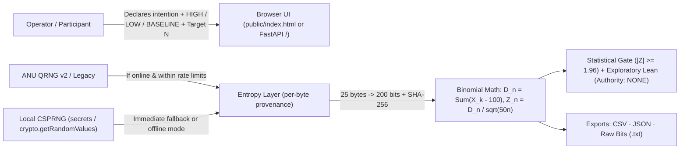

# PEAR Intention RNG

> **DISCLAIMER — EXPLORATORY RESEARCH INSTRUMENT ONLY**  
> This project is an open-source, auditable implementation of a Princeton Engineering Anomalies Research (PEAR) tripolar Random Event Generator (REG) experiment. Random-bitstream fluctuations are **not** scientific proof of anomalous cognition and carry **zero decision-making, legal, or safety authority** (including any decisions regarding energetic materials such as lead azide or public-safety operations).

---

## What Is This? (Plain-English Explainer)

In classic **PEAR Laboratory** experiments, a participant focuses an intention (`HIGH`, `LOW`, or `BASELINE`) while a random bit generator outputs streams of **200-bit trials**. Instead of trusting an opaque external dashboard or letting an operator stop a live chart the moment a random walk happens to look "interesting," this repository builds **falsifiability and receipt-level provenance** straight into the instrument:

1. **Every trial is verifiable bytes, not vibes:** Each 200-bit trial (`25` bytes) stores exact raw bits, `bytes_sha256`, and the exact `entropy_source` (`anu_v2`, `anu_legacy`, `secrets_fallback`, `secrets_local`, or `browser_csprng`). If ANU QRNG is rate-limited or offline, the fallback is tagged transparently on every trial—PRNG bits never masquerade as quantum.
2. **Visual random-walk honesty (`±1.96σ` envelope):** A fair coin walk spreads out as $\sqrt{n}$. Plotting cumulative deviation alongside its **95% null envelope** ($\pm 1.96\sqrt{n \cdot M / 4}$) makes ordinary drift obvious on sight.
3. **Pre-registered stopping rules (`planned_trials`):** Stopping a live random walk whenever `|z|` crosses a threshold turns noise into false positives. Sessions default to a pre-registered target `N = 50` and flag early stops or open-ended runs (`UNFIXED_OPEN_ENDED`).
4. **Dead-Salmon Negative Control (`Thesis 54`):** Includes a dedicated `dead_salmon` mode (forced `BASELINE`, zero intention) so anyone can measure how often pure random noise triggers false directional leans or mid-run threshold peeks.

### Why Dead-Salmon Controls & Pre-Registration Matter

Testing [`app.py`](app.py) across **100 zero-intention `dead_salmon` sessions** (`50` trials × `200` bits = **`1,000,000` bits** from Python `secrets`) yielded:

| Metric on 100 Zero-Intention Runs | Result | Why It Matters |
|---|---|---|
| Raw directional lean (`z != 0` → `HIGH` vs `LOW`) | **99 / 100** fired (`52` HIGH, `47` LOW) | Mapping raw `z` sign to a binary decision fires ~99% of the time on pure noise |
| Live-peek excursion (`\|z\| >= 1.96` at *any* trial `1..50`) | **33 / 100** crossed (`max \|z\| = 3.3941`) | Watching a chart and stopping at a peak inflates false positives from 5% to 33% |
| Pre-registered fixed-`N` gate (`\|z\| >= 1.96` at `N = 50`) | **4 / 100** crossed (`4%`) | Matches theoretical two-sided $\alpha = 0.05$ null expectation |

See [`PROTOCOL_AUDIT.md`](PROTOCOL_AUDIT.md) for the full audit against [`NachoBusiness17/falsifier-index`](https://github.com/NachoBusiness17/falsifier-index) and [`NachoBusiness17/mycelial-republic`](https://github.com/NachoBusiness17/mycelial-republic) (including a comparison with HeartMath/GCP 2.0 post-hoc event matching).

---

## Architecture



### PEAR Trial Math (`M = 200` bits by default)

- Trial sum: $X_k = \sum_{i=1}^{M} b_{k,i} \sim \text{Binomial}(M, 0.5)$
- Expected mean: $\mu_T = M / 2 = 100$ · Trial variance: $\sigma_T^2 = M / 4 = 50$ ($\sigma_T \approx 7.0711$)
- Cumulative deviation after $n$ trials: $D_n = \sum_{k=1}^{n} (X_k - \mu_T)$
- Running Stouffer Z-score: $Z_n = \dfrac{D_n}{\sqrt{n \cdot M / 4}}$ · Two-sided $p = \operatorname{erfc}(|Z_n| / \sqrt{2})$

---

## 3 Ways Anyone Can Run It

### 1. Zero-Install Browser Mode (`public/index.html`)
No Python, no `pip`, no server needed:
- Download [`public/index.html`](public/index.html) and **double-click it** in any modern browser, or serve it via **GitHub Pages**.
- Uses `crypto.getRandomValues`, `crypto.subtle` SHA-256 checksums, `localStorage` session persistence, inline `<canvas>` `±1.96σ` plotting, and CSV / raw-bits / JSON export.

### 2. Deploy to Vercel (Static UI + Stateless `/api/qrng` Relay)
This repo is pre-configured for **Vercel** (`public/index.html` + [`api/qrng.py`](api/qrng.py) + [`vercel.json`](vercel.json)) with zero database cold-start issues:
1. Fork or import **`NachoBusiness17/pear-intention-rng`** in Vercel (**Import Git Repository** → keep root directory `.` → click **Deploy**).
2. *(Optional)* Add `ANU_QRNG_API_KEY` in Vercel Project **Environment Variables** to use the ANU Quantum Numbers v2 API server-side (otherwise `/api/qrng` tries legacy ANU QRNG and falls back cleanly to Python `secrets`).
3. Sessions stay private in each visitor's own browser (`localStorage`), while `/api/qrng` avoids browser CORS blocks and never leaks server API keys.

### 3. Full Local Lab (`app.py`: FastAPI + SQLite + Chart.js)
**Dependencies:** Python `>=3.11`, `fastapi>=0.115.0`, `uvicorn>=0.30.0` (declared in [`requirements.txt`](requirements.txt) and [`pyproject.toml`](pyproject.toml)).

- **One-step auto-bootstrap (creates `.venv` + installs dependencies):**
  - macOS / Linux: `./run.sh`
  - Windows (double-click or PowerShell): `.\run.bat`
- **With [`uv`](https://docs.astral.sh/uv/):** `uv run app.py`
- **Manual `venv` + `pip`:**
  ```bash
  python3 -m venv .venv
  source .venv/bin/activate   # Windows: .\.venv\Scripts\Activate.ps1
  pip install -r requirements.txt
  python app.py
  ```
  Then open `http://127.0.0.1:8000`.

| Environment Variable | Default | Purpose |
|---|---|---|
| `PORT` | `8000` | Listen port for `app.py` |
| `HOST` | `127.0.0.1` | Bind host (`0.0.0.0` for LAN/VPS) |
| `PEAR_RNG_DB` | `./pear_rng.db` | SQLite database file path |
| `ANU_QRNG_API_KEY` | *(unset)* | Optional ANU Quantum Numbers v2 API key (kept server-side only) |

---

## Repository Layout

| Path | Role |
|---|---|
| [`public/index.html`](public/index.html) | Zero-dependency standalone browser UI (upgrades automatically to `/api/qrng` on Vercel) |
| [`api/qrng.py`](api/qrng.py) | Stateless Vercel Python serverless relay for ANU QRNG + `secrets` fallback |
| [`vercel.json`](vercel.json) | Vercel header/routing configuration (`Cache-Control: no-store` on `/api/*`) |
| [`app.py`](app.py) | Single-file FastAPI + SQLite + Chart.js local lab server (with missing-dependency guard) |
| [`run.sh`](run.sh) / [`run.bat`](run.bat) | Cross-platform one-click `.venv` + dependency bootstrappers |
| [`pyproject.toml`](pyproject.toml) / [`requirements.txt`](requirements.txt) | Python packaging & runtime dependency definitions |
| [`PROTOCOL_AUDIT.md`](PROTOCOL_AUDIT.md) | Formal evaluation against `falsifier-index` and `mycelial-republic` rules |
| [`test_app.py`](test_app.py) | Unit + live `uvicorn` HTTP integration tests |

## Tests

```bash
python3 -m unittest -v test_app.py
```

## Provenance & Credits

- Original handoff specification spark: `@LilithDatura` ([x.com/LilithDatura/status/2125180506774151448](https://x.com/LilithDatura/status/2125180506774151448), `2026-11-24`)
- Audit framework & non-capture standards: [`NachoBusiness17/falsifier-index`](https://github.com/NachoBusiness17/falsifier-index) · [`NachoBusiness17/mycelial-republic`](https://github.com/NachoBusiness17/mycelial-republic)
- License: [MIT](LICENSE)
